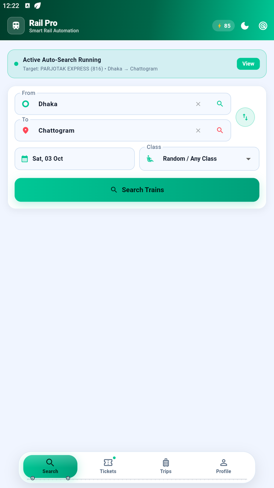
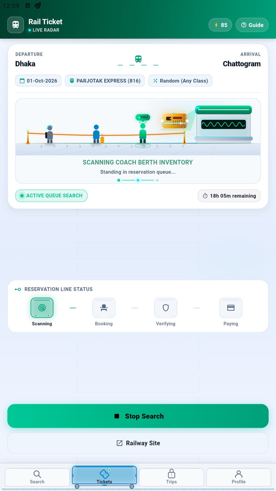
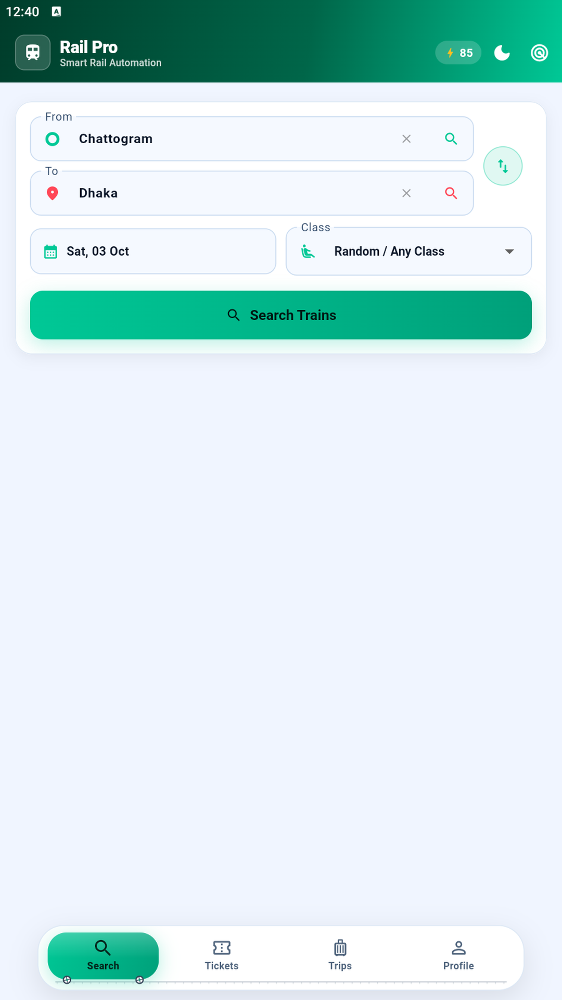

<div align="center">

  

  # Rail Pro (বাংলাদেশ রেলওয়ে অটোমেশন)
  ### Smart Bangladesh Railway Ticket Monitoring & Auto-Reservation Assistant

  [](https://github.com/about-shihab/rail_automation/releases)
  [](https://github.com/about-shihab/rail_automation)
  [](https://flutter.dev)
  [](test/)
  [](https://about-shihab.github.io/rail_automation/)

  <p align="center">
    <strong>Never miss an open train seat again.</strong> Continuous route monitoring, multi-train selection, multi-coach seat booking, and secure Google SMS User Consent OTP verification for Bangladesh Railway.
  </p>

  <p align="center">
    <a href="https://about-shihab.github.io/rail_automation/"><strong>🌐 Visit Official App Website »</strong></a>
    &nbsp;•&nbsp;
    <a href="#-direct-apk-download"><strong>📥 Download APK »</strong></a>
    &nbsp;•&nbsp;
    <a href="PRIVACY_POLICY.md"><strong>📄 Privacy Policy »</strong></a>
  </p>

</div>

---

## 📸 App Preview

| Ticket Search & Radar | Queue Waiting Room | Multi-Coach Seat Layout |
|:---:|:---:|:---:|
|  |  |  |
| *256 Canonical stations with class filters* | *Intelligent waiting room queue handling* | *Select up to 4 seats across different coaches* |

---

## ⚡ Key Features

* 🚆 **Multi-Train Auto-Booking**: Bangladesh Railway returns multiple trains per route in a single API call. Monitor and auto-book across multiple target trains (e.g. *Subarna Express*, *Sonar Bangla Express*, *Mohanagar Provati*) without interrupting or resetting your route.
* 💺 **Multi-Coach Seat Flexibility**: Auto-book up to 4 tickets across any coaches on the train. You are no longer restricted to a single coach when seats are scattered.
* ⏱️ **Departure-Time Monitoring**: No artificial 60-minute cutoff. Monitoring searches non-stop until the train's scheduled departure time.
* 📲 **Google SMS User Consent API**: Google asks to share one Railway OTP message, then the app verifies it without SMS-reading permissions. Manual entry remains available.
* 💳 **Dynamic Cloud Credit System**: Firestore database integration dynamically syncs credit packages in real-time. Exactly **1 credit** is deducted per auto-book reservation when seat hold & OTP are triggered.
* 🌓 **Dark Mode & Bilingual**: Sleek, battery-friendly dark theme with one-tap switching between Bangla (বাংলা) and English.
* 🔒 **Secure Device Storage**: Platform secure storage for action tokens and session data. Direct HTTPS connection to official Bangladesh Railway portal.

---

## 📥 Direct APK Download

| File | Version | Architecture | Minimum Android | Download Link |
| :--- | :---: | :---: | :---: | :--- |
| `Rail-Pro-v1.0.1.apk` | **v1.0.1** | `universal` (arm64, armeabi-v7a, x86_64) | Android 7.0 (API 24+) | [**Download APK**](https://github.com/about-shihab/rail_automation/releases/download/v1.0.1/Rail-Pro-v1.0.1.apk) |

---

## 🛠️ Project Structure

```text
rail_automation/
├── android/                  # Android native project & release signing configs
├── assets/                   # App icons and audio sound cues
├── docs/                     # GitHub Pages app website (index.html & assets)
├── lib/
│   ├── models/               # Data models (TrainTrip, SeatType, BookingIntent, CreditPackage)
│   ├── services/             # Core engines (BookingService, MonitorService, CreditService, SmsService)
│   ├── utils/                # Design system tokens (AppColors, AppCard, Typography)
│   ├── views/                # Screens (SearchScreen, AppShell, SeatBookingScreen, MonitorDashboard)
│   └── widgets/              # Reusable components (TrainNavigationBar, TurnstileSheet)
├── test/                     # Automated unit and widget tests
└── PRIVACY_POLICY.md         # Store-compliant privacy policy
```

---

## 🚀 Building & Running Locally

### Prerequisites
* Flutter SDK with Dart 3.13.1 or later, compatible with `pubspec.yaml`
* Android SDK / Android Studio
* Connected Android Device or Emulator

### Commands
```bash
# Get dependencies
flutter pub get

# Run test suite
flutter test

# Run in debug mode
flutter run

# Build signed production release APK
flutter build apk --release
```

---

## 👨‍💻 Developer Information

* **Lead Developer & Creator**: **Abdulla Al Mamun**
* **Email**: [`connect.abdulla@gmail.com`](mailto:connect.abdulla@gmail.com)
* **GitHub**: [@about-shihab](https://github.com/about-shihab)

---

## 🛡️ Official Disclaimer

> **Disclaimer**: Rail Pro is an independent automation and train ticket monitoring utility designed to assist users with personal ticket availability search and booking on the Bangladesh Railway portal.
>
> This application is **not affiliated with, endorsed by, or operated by Bangladesh Railway (BR)** or Shohoz-Synesis-Vincen JV. All ticket reservations, fares, OTPs, and seat allocations are processed directly through the official railway ticketing portal (`eticket.railway.gov.bd`).

## Booking verification

Seat availability monitoring does not run Turnstile challenges. An invisible `InAppWebView` is preloaded once by the app host, with Turnstile rendered in `execution: 'execute'` mode. When booking needs a seat layout, the existing widget generates a fresh token immediately before that API request. The in-app ticket overlay exposes the same browser when an interactive checkbox is required.

- Concurrent layout requests for the same trip share one read and one overlay.
- A manually selected booking reuses its loaded layout during reservation.
- Each layout read submits its token once as `cft_response`. Reservation calls use Railway's separate action-token header and never reuse the Turnstile token.
- There is no preliminary unverified layout request and no automatic retry of a rejected fresh token. Retry is an explicit user action.
- Unsubmitted tokens expire locally after four minutes and are removed before submission.
- A background challenge produces one notification. Opening the app resumes the pending check; dismissing it requires an explicit retry.
- Reservation and OTP mutations are never retried by the verification gate. A further server rejection needs user attention instead of another automatic prompt.

The Android foreground-service isolate requests tokens from the retained UI browser through a correlated message bridge. The browser stays mounted across navigation and while the app is minimized. A booking-time token refresh shows the existing ticket-loading animation. The preloaded browser runs Turnstile without rebuilding; a checkbox appears only if Cloudflare asks for interaction. Notification taps start a pending check before preference writes and alert cleanup. While minimized, the service can attempt a silent booking-time check through the retained browser. If human interaction is required or Android has destroyed that browser, one seat-found notification asks the user to return. If Android destroys the UI engine, its WebView cannot survive: the worker falls back to a pending notification after a short acknowledgement timeout, and reopening the app preloads it again. Pending verification resumes when the app is opened. Preloading removes browser startup from the normal booking path; it does not guarantee instantaneous Cloudflare verification or network responses.

The booking, popup, warm-browser and foreground-bridge tests use mocked Railway responses and a fake WebView. `node test/turnstile_bootstrap_test.cjs` exercises the embedded JavaScript against the Turnstile interface. `test/ticket_processing_design_test.dart` checks narrow layouts in both themes and writes previews under `build/design-preview/`. The WebView dependency is pinned to `6.2.0-beta.3` because its Android build supports this project's AGP 9 configuration. Live challenge acceptance, background execution and native WebView behavior still require testing on a device.


## Checkout and Android release readiness (October 5, 2026)

Checkout restores Railway storage in a blank HTTPS-origin WebView before loading trip-info. Payment provider pages remain visible. A return to search offers a checkout retry while the reservation is saved. A success URL alone cannot mark a booking paid: confirmation requires a new confirmed, non-refunded Railway purchase with a PNR and matching trip ID, compared with history before checkout.

Seat availability and pending verification share one high-priority Android notification, “Seat found · Tap to book”. The bundled `seat_found.wav` plays a synthesized train whistle followed by the Bangla voice “আপনার ট্রেনের টিকেট পাওয়া গেছে” (bn-BD-PradeepNeural). Positive seat-count updates replace the same alert without repeating its sound. Automatic OTP verification suppresses the manual OTP alert; payment readiness still alerts. Notification display depends on OS settings, notification permission, and Do Not Disturb. Tapping Book resumes booking; returning to the app resumes a pending check. Full-screen and display-over-app permissions are not requested.

Release builds require production signing in `android/key.properties`; debug signing is never a release fallback. See [release readiness](docs/RELEASE_READINESS.md) for remaining store/backend/device requirements. Passing local checks does not establish Google Play approval or live Railway checkout compatibility.
