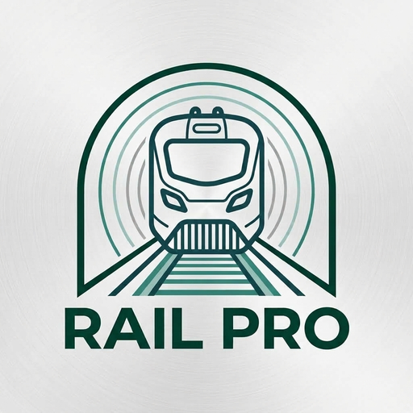

# Rail Pro · রেল প্রো



**আপনার হয়ে ট্রেনের আসনের খোঁজ রাখে।**

[Facebook-এ আমাদের অনুসরণ করুন](https://www.facebook.com/railpro)। অ্যাপ খোলা বা ব্যাকগ্রাউন্ডে থাকলেও নতুন আসন পাওয়া গেলে নোটিফিকেশন যায়। Turnstile ও বুকিং API চলার সময় ট্রেন-টিকিট loading animation দেখায়।

ট্রেনের টিকিট দ্রুত শেষ হয়ে যায়। পরে কেউ টিকিট ফেরত দিলে কিংবা রেলওয়ে বাড়তি বগি যুক্ত করলে আবার আসন পাওয়া যেতে পারে। বারবার নিজে খোঁজ রাখা কঠিন—এই কাজ সহজ করতেই Rail Pro। যাত্রার তথ্য সংরক্ষণ করে রাখুন; আসন পাওয়া গেলে অ্যাপ জানাবে এবং স্বয়ংক্রিয় বুকিং চালু থাকলে রিজার্ভেশন শুরু করবে। টিকিট নিশ্চিত করতে রেলওয়ের পোর্টালে সময়মতো পেমেন্ট করতে হবে।

## যা করতে পারবেন

- স্টেশন, তারিখ, আসনের শ্রেণি ও পছন্দের একাধিক ট্রেনের জন্য একটি সার্চ চালু রাখা।
- আসন পাওয়া গেলে একটি স্পষ্ট নোটিফিকেশন পাওয়া—ট্রেনের হুইসেল ও বাংলা কণ্ঠে “আপনার ট্রেনের টিকেট পাওয়া গেছে”।
- স্বয়ংক্রিয় বুকিং চালু থাকলে এক বা একাধিক বগিতে সর্বোচ্চ চারটি আসন রিজার্ভ করার চেষ্টা করা।
- আপনার অনুমতি নিয়ে রেলওয়ের OTP যাচাই করা; প্রয়োজনে নিজেও কোড লেখা। স্বয়ংক্রিয় যাচাই চালু থাকলে আলাদা OTP-লেখার নোটিফিকেশন আসে না।
- বাংলা/English ভাষা, light/dark theme, সংরক্ষিত সার্চ ও ভ্রমণের ইতিহাস ব্যবহার করা।

আসন পাওয়া বা বুকিং সফল হওয়ার নিশ্চয়তা নেই। প্রাপ্যতা, নিরাপত্তা যাচাই, OTP, রিজার্ভেশন ও পেমেন্টের ফলাফল রেলওয়ের সিস্টেমের ওপর নির্ভর করে। ব্যাকগ্রাউন্ডে সার্চ ও নোটিফিকেশনের জন্য Android-এর অনুমতি ও ডিভাইসের সেটিংস প্রযোজ্য।

## Website, downloads and private repository

Public website: https://about-shihab.github.io/rail-pro/ · [APK releases](https://github.com/about-shihab/rail-pro/releases).

The compact website defaults to Bengali and includes an English switch, animated journey illustration, booking demo, screenshots and FAQ. Preview locally:

```powershell
python -m http.server 8765 --bind 127.0.0.1
```

Open `http://127.0.0.1:8765/docs/`. The demo does not make Railway requests. Animations support reduced-motion preferences.

Keep this source repository private and publish the website, signed APK and `update.json` on public HTTPS hosting. **Private GitHub release links are not public APK downloads.** Download URL/version/size come from the published manifest. The website shows an unavailable state until distribution is ready.

The [release workflow](.github/workflows/android-release.yml) automatically increments versions and builds, then publishes the website through GitHub Pages and the APK through Releases in `about-shihab/rail-pro`. Its `force_update` option makes older supported builds show a mandatory update screen. Setup, secrets, signing continuity and offline behavior are in [UPDATES.md](docs/UPDATES.md). CI/hosting must be configured before publication; a workflow file alone does not deploy the site.

## Development

Use Flutter **3.47.1 / Dart 3.13.1**, Android SDK, Java 17 and a device/emulator. Minimum Android: **7.0 (API 24)**. Configure Firebase and signing for your environment.

```powershell
flutter pub get
flutter analyze --no-pub
flutter test --no-pub
node test/turnstile_bootstrap_test.cjs
python -m unittest discover -s scripts/tests
flutter run
```

Release builds require `android/key.properties` with `storeFile`, `storePassword`, `keyAlias`, and `keyPassword`. Use the original production keystore to update existing installations. Signing secrets are ignored by git. Follow [automatic release instructions](docs/UPDATES.md) rather than editing version labels manually.

| Directory | Contents |
| --- | --- |
| `lib/services` | Monitoring, reservation, OTP, notifications, credits and updates |
| `lib/views`, `lib/widgets` | Screens, retained browser and booking/update interfaces |
| `android` | Native services, package version and release signing |
| `docs` | Bilingual static website, app images and operational documentation |
| `scripts` | Version allocation, CI signing and public distribution bundling |
| `test` | Booking, notification, browser, update and interface checks |

## Building the iOS IPA

Use macOS with Xcode 26 or newer selected. `workmanager_apple` 0.9.11 references iOS 26 SDK types, so Xcode 16 cannot compile it even though the app's minimum iOS version remains 16.0. Both GitHub Actions iOS jobs explicitly select Xcode 26.3 and verify the SDK before building.

On a Mac, run `bash scripts/build_ios.sh` to build and package `build/ios/ipa/RailPro.ipa`. For a hosted build, run the **Standalone iOS IPA Build** workflow with `build_type: unsigned` and download the **RailPro-iOS-IPA** artifact. The unsigned IPA must be signed before installing on a device; Sideloadly or AltStore can handle signing during sideloading.

## Booking and verification

A retained invisible `InAppWebView` keeps the browser and verification widget ready while the app is open. A valid, unused token may be prepared in advance and is consumed once when a booking needs the seat-layout API. There is no access-check loading popup during silent execution. A checkbox appears only when Cloudflare requires interaction. Ordinary API loading stays separate from verification.

Each token is submitted once as `cft_response`. Concurrent layout reads share one request; reservation reuses an already loaded layout. An explicit token rejection triggers one fresh-token retry while the app is open, usually silently; a second rejection requires a deliberate retry. Rate limits, timeouts and server failures do not trigger token-refresh loops. Reservation requests use Railway's separate action-token header and never reuse the Turnstile token. Booking mutations are not retried automatically after an unknown outcome.

On iOS, CFT-bearing API requests retain the verification WKWebView's native user agent and remove desktop Chromium hints. Login and seat-layout challenges use separate configured site keys. Background preparation cannot put an already submitted token back into the cache, and a session refresh never replays the previous layout token. Automated tests verify this handoff using fake callbacks; production acceptance still requires real Turnstile completion on an iPhone.

The foreground-service isolate requests verification from the retained UI browser only while the app is open. Otherwise one seat-found notification asks the user to return. A notification tap starts the pending refresh immediately. A WebView cannot stay alive after Android destroys its engine. Verification speed depends on Cloudflare and the network.

Leaving the app during native seat loading saves the selected train, class, exact journey leg and boarding date and posts an **Open Rail Pro to load seats** notification. Returning or tapping the notification resumes that seat layout with a fresh verification token. Saved context is account-bound, expires after 30 minutes, and contains no tokens or credentials. It never authorizes a reservation or payment.

iOS uses system-scheduled background refresh, with one short native background task to finish an availability check when leaving the app. Pending refreshes are preserved on resume. Locked-screen checks use the background-accessible session and never read protected booking/action-token storage or start seat-layout, reservation, or Turnstile work. Seats found produce a notification; booking continues when the user returns. iOS does not provide a persistent Android-style foreground service or guarantee a polling interval while suspended. Force-quitting, disabling Background App Refresh, and system power policies can prevent background checks. Continuous monitoring while the app is suspended would require a separate server service.

Checkout uses the official Railway flow. A return URL alone cannot mark a ticket paid; confirmation requires a matching new confirmed, non-refunded purchase with a PNR. Tests use fake Railway responses and WebViews. Actual background behavior, challenge acceptance and checkout need physical-device verification. See [release readiness](docs/RELEASE_READINESS.md).

When a train or selected class is sold out, **Search via intermediate station** checks two legs through each stop between your stations. Results require online seats in the same class on the same train run. Both legs show their own date, fare and booking action; overnight departures use the next day's date. Each option requires two separate tickets and may require changing seats. These searches run on demand; they do not auto-book both legs or change background monitoring. This simpler workflow was inspired by [RailwayMatrixBD](https://github.com/AhmedTrooper/RailwayMatrixBD).

On iOS, checkout bounds Railway's optional location lookup to five seconds so an unanswered WKWebView location request cannot block payment submission indefinitely. Android checkout is unchanged. Verify on a physical iPhone after OTP, including with location denied or unavailable. Run `node --test test/ios_checkout_location_test.cjs` for the simulated location timeout checks.

## Privacy and independence

Rail Pro is independent and unaffiliated with Bangladesh Railway or Shohoz-Synesis-Vincen JV. Reservations, fares and payments are processed through the official Railway portal. Read the [privacy policy](PRIVACY_POLICY.md).

Developed by **Abdulla Al Mamun** · [connect.abdulla@gmail.com](mailto:connect.abdulla@gmail.com) · [@about-shihab](https://github.com/about-shihab).
